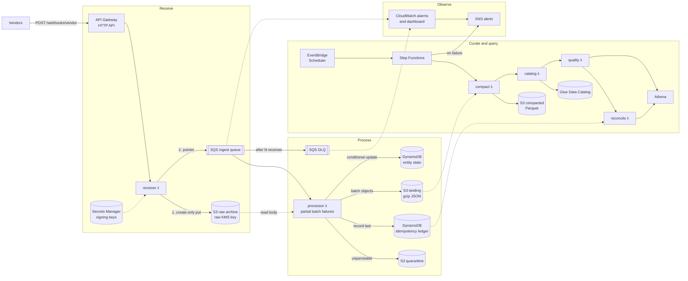
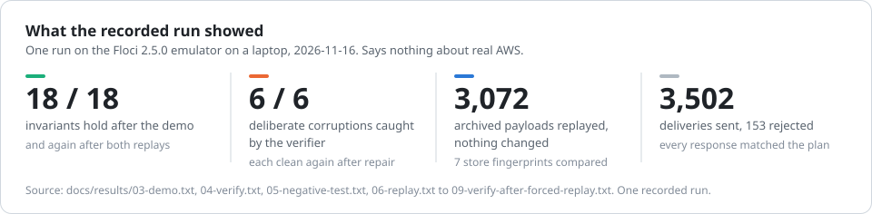

# serverless-webhook-ingestion

A serverless ingestion platform for third-party vendor webhooks in a lending
business: API Gateway, Lambda, SQS, DynamoDB, S3, Glue, Athena, Step Functions,
EventBridge Scheduler, CloudWatch, SNS, KMS, IAM and Secrets Manager, defined entirely
in Terraform, with a proof you can run that it does not lose, duplicate or reorder
anything.

```
$ make demo && make verify
loadgen: sent 3502 in 32.7s = 107.2 req/s
...
PASS  every accepted request is archived, byte-identical                              3349 accepted requests -> 3072 distinct objects, 1,018,605 bytes compared
PASS  state table equals the state computed from ground truth                         1220 entities, every attribute equal (3001 events folded)
PASS  the DLQ contains exactly the poison messages                                    3 messages for 3 payloads; expected 3 payloads x 1
PASS  compacted Parquet has one row per genuine event, content equal                  3001 events in 6 Parquet files, every column equal
...
18 of 18 invariants hold
```

> **Verified against Floci 2.5.0, an AWS emulator, on a laptop. Never deployed to real
> AWS.** Every number on this page comes from a run on that emulator on
> 2026-11-16 (arm64 macOS, Docker). The Terraform root for a real account
> (`infra/envs/aws`) is formatted, validated, linted and scanned, and has never been
> planned or applied. IAM, bucket policies, KMS, throttling, cold starts, alarms on
> Lambda and custom metrics, and partition pruning are **not** verified, because the
> emulator does not evaluate them. The full list is under
> [Emulator versus real AWS](#emulator-versus-real-aws) and
> [Known limitations](#known-limitations). This is a portfolio project, not something
> that has carried production traffic.

## The problem

A lender depends on vendors: a payments processor, a telephony provider, a credit
bureau. Each tells you what happened by POSTing to a URL you give them. Getting that
right is harder than it looks, for reasons that are the same for every vendor:

- **They will not resend.** Once you answer 2xx the vendor's job is done. If you then
  lose the event, a payment that settled shows as pending until a borrower phones.
- **They retry.** Anything but a prompt 2xx is retried for days, so every event can
  arrive more than once, sometimes at the same instant on two connections.
- **They do not deliver in order.** A retry of an old event arrives after a newer one.
  Writing events to state in arrival order shows a settled payment as "initiated".
- **Anyone can POST to your URL.** The only proof a request is genuine is an HMAC over
  the exact bytes of the body, and every vendor computes it differently.
- **They change things.** New event types, new fields, rotated secrets, on their
  schedule, and you find out when it arrives.
- **Some payloads will break your code**, and one that does must not take the rest
  down with it or vanish.

This repository is one answer to those, small enough to read in an afternoon, with
the claims backed by a test harness that tries to break them.

## Architecture

<picture>
  <source media="(prefers-color-scheme: dark)" srcset="docs/img/architecture-dark.svg">
  
</picture>

<details>
<summary>The same diagram as text, with more detail</summary>



</details>

One request, start to finish:

1. **Receive.** The receiver looks up the vendor from the path, verifies the HMAC
   against the vendor's active keys (from Secrets Manager, cached), and checks the
   signed timestamp is within five minutes. A failure is a 401 and leaves no trace.
   Otherwise it writes the exact body to `raw/vendor=/dt=/hour=/<sha256>.body` with a
   create-only put, enqueues a pointer, and answers 202. It never parses the body.
2. **Process.** The processor reads the body back from S3 and normalises it to one
   canonical shape, replacing phone numbers and SSN fragments with keyed tokens. It
   skips events the ledger has seen, applies a conditional state update that only
   moves forward, writes the batch to the landing zone, and records the event in the
   ledger last. Failures are reported per message.
3. **Curate.** Every 15 minutes (every minute on the emulator) a state machine folds
   new landing objects into one deduplicated Parquet file per partition, registers
   partitions in Glue, runs data-quality SQL in Athena, and reconciles the table
   against the ledger. Any failure is published to SNS.

## Run it

Needs Docker, [uv](https://docs.astral.sh/uv/) and make. Nothing else: Terraform runs
from a pinned container, Python 3.12 is fetched by uv. No AWS account, no AWS
credentials, no cost.

```sh
make up              # start the emulator                              1 s
make deploy          # build packages, terraform apply (100 resources) 111 s
make demo            # send the seeded workload, wait for it to settle 212 s
make verify          # check 18 invariants; exit 1 on any violation    10 s
make negative-test   # corrupt the system six ways; verifier must fail 22 s
make replay          # re-drive the whole archive; nothing may change  168 s
make down            # stop and delete everything
```

Times are wall-clock from the recorded run, after images were pulled. A first run also
pulls the emulator, the Lambda base image, the query engine and Terraform (about 1.5 GB
unpacked) and downloads the Terraform AWS provider. Most of
`make demo` and `make replay` is waiting: for the backlog to drain, for each poison
message to fail three times 25 seconds apart and reach the DLQ, and then up to a
minute for the next scheduled pipeline run.

`make down` removes the containers, the network, the Terraform state and the volumes
the emulator leaves behind. Two caches survive it: the images, and a Docker volume
named `webhook-ingestion-tflint-plugins` if you ran `make tf-lint`.

Other targets: `make replay-forced`, `make status`, `make redrive`, `make test`,
`make test-integration`, `make lint`, `make tf-fmt`, `make tf-validate`, `make tf-lint`,
`make security-scan`, `make help`.

**It cannot reach real AWS**, even on a machine with real credentials configured:

- The Makefile exports dummy keys (`test`/`test`), an explicit loopback endpoint,
  empty credential and config files, and unsets `AWS_PROFILE`.
  `scripts/preflight.sh` checks all of that before any target that speaks an AWS
  protocol and refuses to continue otherwise.
- The tools build every client in `src/webhook_tools/sandbox.py` with literal dummy
  keys and an endpoint that must match `http://localhost:<port>`.
- The emulator's Terraform root hard-codes dummy keys, skips credential validation
  and the metadata service, pins every service endpoint to a variable that is
  validated to be a loopback or compose-internal address, and runs in a container
  with no credential files mounted.

## What the demo proves

<picture>
  <source media="(prefers-color-scheme: dark)" srcset="docs/img/verification-dark.svg">
  
</picture>

`make demo` sends a seeded, deterministic workload through the real HTTP endpoint:
3,001 genuine events from three vendors with different signing schemes, wrapped
in 3,502 deliveries that include everything that goes wrong in practice.

| In the workload | Count | What must happen |
|---|---:|---|
| Genuine events, first delivery | 3,001 | 202, archived, processed |
| ...of which signed with the previous key (mid-rotation) | 155 | accepted like any other |
| ...entities whose events arrive newest-first or shuffled | 296 | final state unaffected |
| Exact retransmissions (same bytes, same signature) | 150 | 202, no second archive object, processed once |
| Vendor retries (same body, re-signed) | 120 | 202, processed once |
| Forged or unsigned: altered body, wrong secret, missing or malformed signature, unknown key id | 90 | 401, nothing stored |
| Authentic but an hour old, or an hour in the future | 60 | 401, nothing stored |
| Signed correctly, body is not JSON | 30 | 202, archived, quarantined |
| Signed correctly, event type nobody has seen | 30 | 202, archived, quarantined |
| Signed correctly, required field missing or wrong type | 15 | 202, archived, quarantined |
| Poison: valid by schema, impossible to store | 3 | 202, archived, three attempts, DLQ |
| Unknown vendor path | 2 | 404 |
| Body over 1 MB | 1 | 413 |

Every rejected delivery carries an event that claims a *newer* version of a real
entity, so accepting any of them would change the state table and be caught.

```
loadgen: seed 20261117, 3000 events requested, 3502 deliveries, concurrency 16
loadgen: plan fingerprint 3a70aa1e8952a002 (seed + event count + base time 2026-11-16T23:48:05.000Z)
loadgen: sent 3502 in 32.7s = 107.2 req/s
loadgen: by category   {'body_too_large': 1, 'duplicate_exact': 150, 'duplicate_resigned': 120, 'invalid_signature': 90, 'malformed_json': 30, 'poison': 3, 'schema_invalid': 15, 'stale_timestamp': 60, 'unknown_event_type': 30, 'unknown_vendor': 2, 'valid': 3001}
loadgen: by status     {202: 3349, 401: 150, 404: 2, 413: 1}
loadgen: latency of accepted requests  p50 42.0 ms  p95 1154.66 ms  p99 1897.09 ms  max 3592.68 ms
loadgen: 0 request(s) needed a retry; 0 response(s) differed from the plan
settle: queue drained after 163.2s; 3 message(s) in the DLQ
settle: scheduled pipeline execution SUCCEEDED in 1.87s (waited 14.3s for the schedule): Init > Compact > AnythingLanded > UpdateCatalog > MoreToCompact > DataQuality > Reconcile > Done
```

`make verify` then compares the deployed system with the generator's record of what
it sent. The expected state, the expected PII tokens and the request signatures are
computed by the test harness's own code (`src/webhook_tools`), which imports nothing
from the platform; a unit test enforces that.

```
PASS  every response matches the plan                                                 3502 requests: 3349 x 202, 150 x 401, 2 x 404, 1 x 413
PASS  every accepted request is archived, byte-identical                              3349 accepted requests -> 3072 distinct objects, 1,018,605 bytes compared
PASS  the archive holds each object exactly once and nothing else                     3072 archive objects, one version each, 277 re-deliveries absorbed
PASS  no rejected request is in the archive                                           153 rejected requests, 153 distinct bodies, 0 found in the archive
PASS  archived objects carry digest, signature headers and SSE-KMS under the raw key  3072 objects checked
PASS  the ingest queue is empty                                                       0 visible, 0 in flight
PASS  state table equals the state computed from ground truth                         1220 entities, every attribute equal (3001 events folded)
PASS  idempotency ledger holds exactly the genuine events                             3001 ledger records (2516 applied, 485 stale)
PASS  the DLQ contains exactly the poison messages                                    3 messages for 3 payloads; expected 3 payloads x 1
PASS  quarantine holds exactly the unparseable and unknown payloads                   68 quarantine pointers (23 malformed_json, 15 schema_invalid, 30 unknown_event_type)
PASS  landing zone covers every genuine event and no other                            3001 distinct events in 600 objects (3001 records including duplicates)
PASS  compacted Parquet has one row per genuine event, content equal                  3001 events in 6 Parquet files, every column equal
PASS  Glue catalog has every compacted partition registered                           6 partitions
PASS  Athena counts through the Glue catalog reconcile with accepted unique events    expected {'callwright': 1097, 'meridianpay': 839, 'veritybureau': 1065}; the events table, counted by Athena, has {'callwright': 1097, 'meridianpay': 839, 'veritybureau': 1065}
PASS  the scheduled curation pipeline ran after the queue drained and succeeded       1 execution(s) since drain, 0 failed; states Init > Compact > AnythingLanded > UpdateCatalog > MoreToCompact > DataQuality > Reconcile > Done; 7 data-quality checks, 0 violations
PASS  no raw PII outside the raw bucket                                               10,387,800 characters searched in 7 places
PASS  no secret value in logs, function configuration or queues                       7 secret values, 13 places searched
PASS  the DLQ alarm fired and the notification reached a subscriber                   alarm state ALARM, 1 ALARM notification(s) delivered via SNS

18 of 18 invariants hold
verified in 9.1s
```

**The verifier is shown failing.** `make negative-test` damages the system six ways,
checks the relevant invariants fail, repairs it, and checks they pass again:

```
[1/6] state regressed to an older event
    damaged   FAIL  state table equals the state computed from ground truth: 1 entities differ: payment#pay_00c84bbeaa02 (version, status)
    repaired  PASS  state table equals the state computed from ground truth
    => caught, clean after repair

[2/6] archived payload altered by one byte
    damaged   FAIL  every accepted request is archived, byte-identical: 0 missing: ; 1 altered: raw/vendor=callwright/dt=2026-11-16/hour=23/00028135a9f446c3c15babbd492db40559a50913847c21a0f04feebc5c45feac.body
    damaged   FAIL  the archive holds each object exactly once and nothing else: 1 keys with more than one version: raw/vendor=callwright/dt=2026-11-16/hour=23/00028135a9f446c3c15babbd492db40559a50913847c21a0f04feebc5c45feac.body;
    repaired  PASS  every accepted request is archived, byte-identical
    repaired  PASS  the archive holds each object exactly once and nothing else
    => caught, clean after repair

[3/6] archived payload deleted
    damaged   FAIL  every accepted request is archived, byte-identical: 1 missing: raw/vendor=callwright/dt=2026-11-16/hour=23/00161820a7434238db5d5d37502325c1f8c60c2bd8b729ad41f83d3a0a876a93.body; 0 altered:
    damaged   FAIL  the archive holds each object exactly once and nothing else: 0 keys with more than one version: ; 1 delete markers
    repaired  PASS  every accepted request is archived, byte-identical
    repaired  PASS  the archive holds each object exactly once and nothing else
    => caught, clean after repair

[4/6] rejected request planted in the archive
    damaged   FAIL  the archive holds each object exactly once and nothing else: archive objects: 1 unexpected: raw/vendor=callwright/dt=2026-01-01/hour=00/02c078659ee148f45115d1af321cb5be09bed0664d1bbd98f4d49bd0548c24e9.body, one
    damaged   FAIL  no rejected request is in the archive: 153 rejected requests, 153 distinct bodies, 1 found in the archive
    repaired  PASS  the archive holds each object exactly once and nothing else
    repaired  PASS  no rejected request is in the archive
    => caught, clean after repair

[5/6] idempotency record removed
    damaged   FAIL  idempotency ledger holds exactly the genuine events: ledger records: 1 missing: callwright#000ee430-ef44-4db0-ae6e-876db06d7be1 (2515 applied, 485 stale)
    repaired  PASS  idempotency ledger holds exactly the genuine events
    => caught, clean after repair

[6/6] healthy event sent to the DLQ
    damaged   FAIL  the DLQ contains exactly the poison messages: 4 messages for 4 payloads; expected 3 payloads x 1
    repaired  PASS  the DLQ contains exactly the poison messages
    => caught, clean after repair

negative: 6 of 6 corruptions were caught and repaired
```

**Replay changes nothing.** `make replay` enqueues every archived payload again
(3,072 objects) and compares a fingerprint of every store before and
after, down to S3 object versions:

```
replay: 3072 archived payloads for callwright, meridianpay, veritybureau (all time)
replay: enqueued 3072 pointers as replay-7906dd8cefb4 in 0.3s
replay: queue drained after 135.9s
replay: unchanged             state table                        13c2abc8c8c1b119 -> 13c2abc8c8c1b119
replay: unchanged             idempotency ledger                 9c0a7336b900c3b3 -> 9c0a7336b900c3b3
replay: unchanged             raw archive (all versions)         88fedb12ddd6712f -> 88fedb12ddd6712f
replay: unchanged             quarantine (all versions)          99c001b03a4a8959 -> 99c001b03a4a8959
replay: unchanged             compacted rows                     976a6340040d8ac3 -> 976a6340040d8ac3
replay: unchanged             landing objects (all versions)     2092d492c2f1138f -> 2092d492c2f1138f
replay: unchanged             compacted Parquet (all versions)   6fc3b5b7bc74ca64 -> 6fc3b5b7bc74ca64
replay: 3072 payloads reprocessed, nothing changed
settle: queue drained after 2.0s; 6 message(s) in the DLQ
settle: scheduled pipeline execution SUCCEEDED in 1.89s (waited 26.4s for the schedule): Init > Compact > AnythingLanded > UpdateCatalog > MoreToCompact > DataQuality > Reconcile > Done
```

The only thing that grows is the DLQ: the three poison payloads fail again, as they
should. `make replay-forced` is the stronger version. It tells the processor to ignore
the idempotency ledger, so every event really is processed a second time, and state,
ledger and compacted rows are still identical; only the landing zone and the Parquet
files' versions change, by design:

```
replay: 3072 archived payloads for callwright, meridianpay, veritybureau (all time)
replay: enqueued 3072 pointers as replay-03cd1306da7d in 0.3s
replay: queue drained after 135.9s
replay: scheduled pipeline execution SUCCEEDED after the replay
replay: unchanged             state table                        13c2abc8c8c1b119 -> 13c2abc8c8c1b119
replay: unchanged             idempotency ledger                 9c0a7336b900c3b3 -> 9c0a7336b900c3b3
replay: unchanged             raw archive (all versions)         88fedb12ddd6712f -> 88fedb12ddd6712f
replay: unchanged             quarantine (all versions)          99c001b03a4a8959 -> 99c001b03a4a8959
replay: unchanged             compacted rows                     976a6340040d8ac3 -> 976a6340040d8ac3
replay: rewritten (expected)  landing objects (all versions)     2092d492c2f1138f -> 5fbb302fb953a3ea
replay: rewritten (expected)  compacted Parquet (all versions)   6fc3b5b7bc74ca64 -> 3180772285cdd6a1
replay: 3072 payloads reprocessed, nothing changed
settle: queue drained after 2.0s; 9 message(s) in the DLQ
settle: scheduled pipeline execution SUCCEEDED in 1.88s (waited 66.8s for the schedule): Init > Compact > AnythingLanded > UpdateCatalog > MoreToCompact > DataQuality > Reconcile > Done
```

After both replays `make verify` passes all 18 invariants again
(`docs/results/`). The first time I ran the replay proof it failed: quarantine
objects were being rewritten on every pass, adding an S3 version each time. The
fix was to make that write create-only, like the archive write. That is what
the proof is for.

### Measured, on the emulator

| | |
|---|---|
| Requests sent | 3,502 in 32.66 s, 16 concurrent clients |
| Throughput | 107.2 requests/s |
| Latency of accepted requests (client side) | p50 42.0 ms, p95 1154.66 ms, p99 1897.09 ms, max 3592.68 ms |
| Requests that needed a client retry | 0 |
| Queue drained (including three failed attempts per poison message) | 163.2 s after the last request |
| Scheduled pipeline run after the drain | 1.87 s for compaction, catalog, 7 SQL checks and reconciliation. Runs a minute apart had already compacted most of the data while it was arriving |
| Archive | 3,072 objects, 1,018,605 bytes, compared byte for byte |
| Landing zone | 600 gzip JSON objects compacted into 6 Parquet files |
| `terraform apply` from nothing | 100 resources, 111 s including the package build |

These describe an emulator running Lambda functions as local containers on one
laptop. They show the system works under concurrency and say nothing about AWS: the
latency tail here most likely comes from the emulator starting and sharing local
function containers (I did not profile it), the throughput ceiling is the emulator's,
and none of it should be quoted as a performance figure.

## Design decisions

Short versions. The ADRs in `docs/adr/` have the reasoning and the alternatives.

**Archive before acknowledging, process afterwards** ([ADR 0002](docs/adr/0002-archive-before-ack.md)).
The receiver verifies, stores the bytes, enqueues a pointer, and answers. It does not
parse. Processing inline would be simpler and would turn every parser bug into a lost
event; with the archive first the same bug becomes a message in the DLQ and a
redrive. The cost is two S3 requests per event.

**SQS standard, not FIFO, Kinesis or EventBridge.** One consumer, per-message
acknowledgement, a visibility timeout and a native DLQ are what SQS is. FIFO ordering
would need the entity id, which is inside the body the receiver will not parse, and
FIFO deduplication lasts five minutes while vendors retry for days. Kinesis adds
shards and an ordering guarantee nothing relies on, and a poison record blocks its
shard. EventBridge routes by content, and the content is not read yet.

**Ordering and idempotency at the write, with DynamoDB conditions**
([ADR 0003](docs/adr/0003-idempotency-and-ordering.md)). State moves only to a strictly
greater `(version, event_id)`, in one conditional `UpdateItem`, so the result is the
same for every delivery order. The idempotency ledger is written *last*: every earlier
step is safe to repeat, so a crash anywhere just means the retry redoes harmless work,
and there is no in-progress marker or lease to recover.

**Hand-written idempotency rather than Lambda Powertools.** Powertools is the right
default and does not do ordering. With the ordering condition in place the ledger is
one read and one conditional write, and "record last" is not how Powertools sequences
its record.

**HTTP API rather than REST API.** About 70% cheaper per request and none of the
REST-only features apply. The one that would help is forcing every body to base64,
which makes byte-exactness independent of content type; see the limitation on
non-UTF-8 bodies.

**Quarantine what cannot work, dead-letter what should have**
([ADR 0004](docs/adr/0004-quarantine-and-dlq.md)). Bodies that are not JSON, fail the
schema or carry an unknown event type are acknowledged, kept in the archive and
recorded under `quarantine/` without spending retries. The DLQ is reserved for
failures nobody predicted, so a message there is always worth a look.

**The processor writes its own batch objects instead of using Firehose**
([ADR 0005](docs/adr/0005-curated-zone.md)). Partitioning by the event's own date puts
every copy of an event in one partition, which is what makes deduplication a
per-partition operation. With Firehose that needs dynamic partitioning, which the
emulator does not implement and which costs extra. Writing directly also gives
deterministic object names. It gives up batching across invocations, which is why
there is a compactor.

**Compaction in a Lambda with pyarrow, orchestrated by Step Functions.** On AWS this
could be an Athena `INSERT INTO`. The emulator runs neither that nor the native
Athena integration for Step Functions, and I would not ship a path that had never
executed. The limit is honest: a partition is merged in memory.

**Lambda rather than a container service.** Traffic is bursty and usually near zero,
the functions are stateless, and nothing here justifies two always-on tasks and a
load balancer. By the estimate in `docs/deploying-to-aws.md`, all Lambda compute at a
million requests a month comes to under a dollar.

**Terraform never holds a secret; PII never leaves the raw bucket**
([ADR 0006](docs/adr/0006-secrets-and-pii.md)). Terraform creates empty secrets and
values are written out of band. Functions read them at runtime and cache them. Phone
numbers and SSN fragments become keyed HMAC tokens before anything leaves the
processor, because a plain hash of four digits is a lookup table.

## Failure modes

| What fails | What happens | What it costs |
|---|---|---|
| Receiver cannot write to S3 | 500 to the vendor, nothing enqueued. The vendor retries | Delay |
| Receiver archives, then cannot enqueue | 500. On the vendor's retry the put finds the object already there and the pointer is enqueued | Delay |
| Receiver times out after both writes | The vendor retries; the retry is a duplicate and is absorbed | Nothing |
| Vendor rotates a secret | 401s until the new key is in Secrets Manager; then each receiver re-reads on its next failed verification. Old and new keys verify side by side | Delay bounded by the vendor's retry window |
| Same event delivered twice | Second archive put is a no-op if the bytes and signed timestamp are equal. The processor skips it at the ledger | One S3 request, one read |
| Same event processed twice at once | Both apply state (the second is a no-op), both write to landing, one records the ledger entry. The compactor keeps one row | A duplicate landing record until compaction |
| Older event after newer | Conditional update fails; recorded as `stale`. Still lands in curated: it happened | One failed write |
| Processor crashes mid-batch | Unacknowledged messages reappear after the visibility timeout. Everything done so far is safe to redo | Delay |
| DynamoDB or S3 errors in the processor | That message is reported failed and retried; the rest of the batch is not | Delay; DLQ if it outlasts the retries |
| Payload the code cannot handle | Fails every attempt, moves to the DLQ, alarm fires. Bytes are in the archive. Fix, deploy, `make redrive` | Human time |
| Vendor sends a new event type | Quarantined, metric incremented. Add the mapping, replay those hours | Curated data is missing that type until then |
| Compactor fails or is down | Landing objects accumulate (14-day retention). Alarm on the failed execution. Next successful run catches up | Stale Athena tables |
| Compactor crashes between data and manifest | Next run folds the same objects in again; the merge discards them | Nothing |
| Data-quality check or reconciliation fails | Execution fails and publishes the details to SNS | Human time |
| A whole table is lost | Restore from point-in-time recovery, or forced replay from the archive | Hours |
| The raw bucket is lost | Unrecoverable. This is the one copy of what vendors sent; see limitations | Everything |

`docs/runbook.md` has the on-call procedure for each alarm.

## Emulator versus real AWS

What the run on this page did and did not exercise. "Executed" means the emulator
performs the behaviour and the verifier checked its result.

| | On Floci 2.5.0 | Verified? |
|---|---|---|
| Lambda | Each function runs in a container from `public.ecr.aws/lambda/python:3.12` with the declared memory limit | Executed. Cold starts, concurrency scaling and throttling are not AWS's |
| API Gateway HTTP API | Lambda proxy, payload format 2.0, served under a path on one host | Executed. Throttling, access logging and the real invoke URL are not exercised |
| SQS | Visibility timeout, redrive to DLQ after `maxReceiveCount` | Executed |
| SQS to Lambda | Event source mapping with partial batch responses | Executed. Scaling behaviour is not AWS's |
| DynamoDB | Conditional writes, global secondary indexes, strongly consistent reads | Executed. TTL expiry, capacity and throttling are not exercised |
| S3 | Versioning, create-only puts, object metadata, SSE headers | Executed. Bucket policies are stored and not evaluated (a put over plain HTTP succeeds despite the deny-insecure-transport statement). Lifecycle rules are stored; none had time to act |
| KMS | Keys exist and are referenced by every encrypted resource | **Not verified.** Whether anything is encrypted at rest is not observable, and no key policy is evaluated |
| IAM | Roles and policies are created | **Not verified.** The emulator does not enforce IAM in this configuration, so a missing or wrong permission would go unnoticed |
| Secrets Manager | Values stored and read | Executed. Resource policies and rotation are not |
| Step Functions | Pass, Task, Choice, Retry, Catch, Fail, `lambda:invoke`, `sns:publish` | Executed. Log delivery was not checked; X-Ray is off in the emulator root |
| EventBridge Scheduler | Starts the state machine on a `rate()` schedule | Executed |
| Glue Data Catalog | Databases, tables, partitions | Executed as API calls. Partition metadata and projection are ignored by the query engine |
| Athena | SQL run by DuckDB, not Trino. Nothing was written to the workgroup's result location | Executed for the Parquet table with engine-neutral SQL. Trino semantics, partition pruning and the workgroup's scan limit are not verified |
| CloudWatch alarms on SQS metrics | Evaluated. `AWS/SQS` is the only metric namespace the emulator populated (`make status`). The DLQ alarm fired and its notification reached the SNS subscriber | Executed for DLQ depth. The queue-age alarm reads the same namespace and stayed `OK`; it was never driven over its threshold, so its firing is not demonstrated |
| CloudWatch alarms on Lambda, API Gateway, Step Functions and custom metrics | Created. No metrics exist in those namespaces, so the alarms sit in `OK` (missing data treated as not breaching) or `INSUFFICIENT_DATA` | **Not verified** |
| Embedded metric format | Lines are written to logs; nothing extracts metrics from them | Format is unit-tested. **Extraction not verified** |
| CloudWatch dashboard | Stored | **Not verified** |
| SNS | Topic, subscription, delivery to SQS | Executed. Email delivery and topic encryption are not |
| TLS | The emulator speaks plain HTTP | **Not verified.** Every "deny insecure transport" policy is unexercised |

Terraform on the emulator: `apply` creates all 100 resources. A second `plan` is not
empty. The emulator does not return the Athena workgroup's result-encryption settings
or the Glue database's tags, so those two resources show as in-place updates, and so
do three IAM policies whose documents are computed from the database (five changes,
observed during development). Applying again is harmless and changes nothing real.

## Security model

- **Authentication.** Per-vendor HMAC over the raw body, constant-time comparison,
  five-minute timestamp tolerance, checked before anything is stored. Verification
  failures get one opaque 401 whatever the reason.
- **Least privilege, one role per function.** Six functions, six roles, each with the
  actions its code calls on the resources it calls them on. The receiver can write to
  the raw bucket and cannot read it. The processor can read it and cannot write. The
  only `Resource: "*"` statements are X-Ray and Step Functions log delivery, which do
  not accept a resource, and KMS key policies, where it is the only valid value.
- **Two KMS keys.** One for the raw archive, one for everything derived. Within this
  stack only the processor's role is granted Decrypt on the raw key. An operator who
  runs replays needs it granted on their own role and has to be on the bucket's reader
  list.
- **Raw bucket policy.** Denies non-TLS access, denies puts not encrypted with the raw
  key, denies reads to every principal not on an explicit list, and denies deletes and
  policy changes to all but admin roles. Versioned, public access blocked, access
  logged.
- **PII.** Phone numbers and SSN fragments are replaced with keyed tokens; names and
  dates of birth are dropped. Queues and quarantine hold pointers, never payloads.
  Logs carry ids and reasons, never bodies, headers or tracebacks.
- **Secrets.** Never in Terraform state, variables or environment variables. The
  verifier searches logs, function configuration and queues for every secret value.
- **Retention.** Raw payloads seven years by default (set it from the lender's
  policy), landing 14 days, query results 7 days, logs one year.
- **Static scan.** checkov: 533 passed, 0 failed,
  68 skipped. Every suppression is in place with its reason and
  listed in [docs/security-scan.md](docs/security-scan.md).

What is verified is what the code does: no PII or secret outside the raw bucket,
nothing stored for a rejected request. What is designed and **not** tested is what the
policies enforce, because the emulator does not evaluate IAM, bucket policies or KMS.

## Cost

Nothing here has run on AWS, so there is no bill to show. A hand-built estimate from
public list prices, with every assumption stated, is in
[docs/deploying-to-aws.md](docs/deploying-to-aws.md): **about $43 to $50 a month for a
million webhooks a month**, of which roughly half is fixed (keys, secrets, alarms,
custom metrics, a pipeline that runs every 15 minutes regardless). The largest lines
are CloudWatch custom metrics and S3 PUT requests, not compute. It is an estimate.

## What changes at 100x

A hundred million events a month is about 40 a second on average, with bursts well
above that. What I would change, in the order it would start to hurt:

1. **The landing zone.** One object per batch per partition becomes millions of small
   objects, and the compactor finds new ones by listing. Replace the processor's
   writes with Firehose and dynamic partitioning (or write straight to Iceberg), and
   drive compaction from S3 event notifications instead of a listing.
2. **Compaction.** Merging a partition in a Lambda's memory stops working when a
   day of one vendor is gigabytes. Move to Iceberg tables with Athena `MERGE` and
   `OPTIMIZE`, which is this job done properly; the manifest bookkeeping here is a
   small hand-made version of what Iceberg snapshots do.
3. **The archive.** A hundred million PUTs is $500 a month and a hundred million tiny
   objects a month is unpleasant to list, replay and expire. Keep the create-only
   write on the request path (it is what makes acknowledgement safe) and roll hourly
   partitions up into a few large objects in the background.
4. **DynamoDB keys.** Per-entity keys spread well. The reconciliation index is keyed
   by vendor and day; at this rate one vendor-day takes all of a vendor's index
   writes, so add a shard suffix to that key.
5. **Processor concurrency and batch size.** Raise both and watch the tables. On-demand
   capacity is fine until a burst outruns its scaling; at a steady 40 a second,
   provisioned capacity with autoscaling is cheaper.
6. **Metrics.** Per-vendor, per-reason custom metrics are already the largest cost
   line. Drop to per-vendor and take reasons from logs.
7. **The receiver.** It should be fine: it is stateless and does two writes. Request
   an account concurrency limit that covers the largest vendor burst, and reserve
   concurrency so nothing else in the account can starve it.

What I would not change: archive before acknowledging, ordering at the write, the
ledger written last, and the verifier.

## Known limitations

- **Never run on AWS.** Stated at the top and worth repeating. The real-AWS root is
  validated, not applied. I expect the first real deployment to need fixes, most
  likely in IAM and KMS policies; `docs/deploying-to-aws.md` lists where.
- **IAM, KMS, bucket policies, TLS and lifecycle rules are untested**, because the
  emulator stores them without evaluating them.
- **The SQL has only run on DuckDB.** The emulator's Athena is DuckDB, not Trino. The
  checks use syntax I believe is common to both and have never run on Athena.
- **The landing table is defined but not queried.** The emulator infers JSON column
  types from the data instead of the Glue schema and failed on one vendor's
  UUID-shaped ids ([ADR 0001](docs/adr/0001-emulator.md)). All SQL in the pipeline
  reads the Parquet table.
- **Bodies that are not valid UTF-8 are rejected.** An HTTP API hands a JSON body to
  Lambda as text, so invalid byte sequences are altered before the receiver sees them
  and the signature fails. It fails closed. A vendor that needed it would need a REST
  API with binary media types.
- **A vendor retry re-signed in a later hour is archived again.** Exact retransmissions
  collapse to one object; a retry with a new signed timestamp in a different hour does
  not. Deduplication by event id happens in the processor.
- **State is "latest version wins".** There is no transition validation, and a vendor
  that reuses a version number for different events gets a deterministic but
  arbitrary winner.
- **Schema validation is structural.** It does not bound every value, which is exactly
  how the demo's poison message gets through to fail at the write.
- **A partition is compacted in memory**, so its size is bounded by the compactor's
  memory.
- **Reconciliation covers a recent window** (48 hours by default), and can report a
  false difference for an event whose processing was retried across the window's
  edge.
- **Timings are an emulator on a laptop.** No latency or throughput figure here
  transfers to AWS.
- **Single region, one copy of the archive.** No cross-region replication and no
  Object Lock.
- **No custom domain, WAF or code signing.**
- **The pre-commit configuration has never run.** The CI workflow has: it runs the
  same Makefile targets I ran locally, on GitHub's x86_64 runners, where the
  compactor package is built for a different architecture than on my machine. The
  first run on `main` passed all three jobs, including the package import check and
  the full deploy, demo, verify, negative test and both replays (about 14 minutes).
  That is the only evidence for the x86_64 path; locally I could build that package
  but not import-check it, because Python under QEMU emulation on arm64 died with a
  segmentation fault.
- **The replay and redrive tools are emulator-only.** They refuse any endpoint that is
  not loopback. Operating a real deployment needs the same logic with real
  credentials, which is not in this repository.
- **The emulator's Lambda base image tag moves.** Floci and its DuckDB sidecar are
  pinned; the `public.ecr.aws/lambda/python:3.12` image Floci pulls is not.

## Tests and checks

| | What | Recorded result |
|---|---|---|
| `make test` | 225 unit tests: signatures (cross-checked against the generator's independent signer), ordering, PII, key derivation, normalisation, compaction, reconciliation windows, the data-quality SQL in DuckDB, and both handlers against moto | pass, 3.77 s |
| `make lint` | ruff (lint and format) and mypy `--strict` on the Lambda code | pass |
| `make tf-fmt`, `make tf-validate` | `terraform fmt -check` and `validate` on both roots | pass |
| `make tf-lint` | tflint with the AWS ruleset, every module and root | no findings |
| `make security-scan` | checkov | 533 passed, 0 failed, 68 skipped |
| `make test-integration` | 5 tests through the HTTP endpoint against the deployed stack | pass |
| `make verify` | 18 invariants, three times: after the demo, after replay, after forced replay | pass |
| `make negative-test` | 6 corruptions | all caught |

The captured output of each is in `docs/results/`.

Lambda packages are built reproducibly by `scripts/build_lambdas.py` (sorted entries,
fixed timestamps, dependencies from `uv.lock`): `core.zip` (38,238 bytes, pure
Python, any architecture) and `compactor.zip` (32,387,941 bytes, pyarrow for
one architecture). The emulator runs functions on the Docker host's architecture, so
the build targets that: **arm64** in the recorded run, x86_64 on GitHub's runners.
The real-AWS root defaults to arm64. `scripts/check_package.sh` imports the built
package inside the Lambda base image to catch a wrong wheel before deploying.

## Repository layout

```
src/webhook_platform/        Lambda code
  signatures.py vendors.py     per-vendor HMAC verification (pure)
  archive.py layout.py         object key layouts (pure)
  normalize.py pii.py          vendor payload -> canonical event, tokenisation (pure)
  ordering.py                  the ordering rule, as Python and as a DynamoDB condition
  store.py landing.py          DynamoDB writes, landing objects
  compaction.py                merge and Parquet encoding
  reconciliation.py            reconciliation windows (pure)
  handlers/                    receiver, processor, compactor, catalog, quality, reconcile
  sql/dq/                      data-quality checks, one SQL file each
src/webhook_tools/           load generator, verifier, replay, redrive, negative test
                             (imports nothing from webhook_platform)
infra/
  modules/                   lambda_function, storage, ingest, processing, analytics,
                             observability, and platform, which wires them together
  envs/local/                emulator root: dummy credentials, pinned endpoints
  envs/aws/                  real-AWS root: validated, never applied
tests/unit/                  pure logic and handlers (moto)
tests/integration/           against the deployed emulator stack
scripts/                     package build, preflight guard, tflint, checkov
docs/
  adr/                       six decision records, starting with the emulator choice
  runbook.md                 on-call procedures per alarm
  vendors.md                 the three vendors' signing schemes and payloads
  deploying-to-aws.md        what a real deployment needs; cost estimate
  security-scan.md           every checkov suppression and its reason
  results/                   captured output of the recorded run
```

## License

MIT. Copyright (c) 2026 Linus Dominic Nathaniel.
